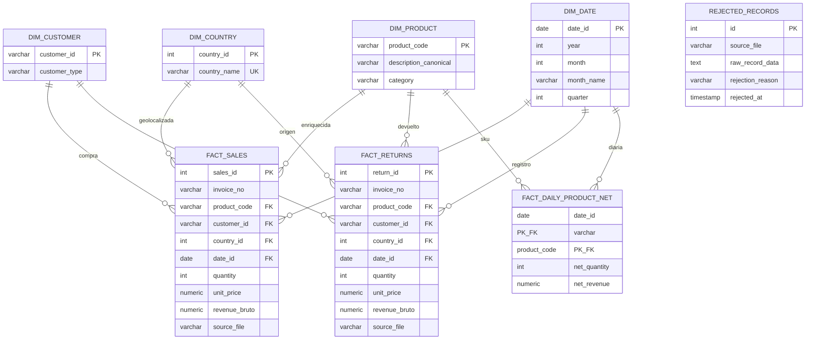

# DataMart ETL — Pipeline con Apache Airflow y PostgreSQL

Prueba de desempeño Riwi · Ingeniería de Datos · Cohorte 7.

## Requisitos
- Docker y Docker Compose
- El CSV de ventas (Kaggle: `gabrielramos87/an-online-shop-business`)

## Puesta en marcha (paso 1: entorno)

```bash
git clone <url-del-repo> && cd datamart-etl
cp .env.example .env
# Genera la Fernet key y pégala en AIRFLOW_FERNET_KEY dentro de .env:
python -c "from cryptography.fernet import Fernet; print(Fernet.generate_key().decode())"
# Coloca el CSV descargado como data/raw/sales_transactions.csv
docker compose up --build -d
```

Airflow queda en http://localhost:8080 (usuario y clave: `AIRFLOW_ADMIN_USER` / `AIRFLOW_ADMIN_PASSWORD` de tu `.env`).

## Verificar que todo quedó bien

1. Servicios arriba: `docker compose ps` (webserver y scheduler `healthy`/`running`; `airflow-init` termina en `Exited (0)`).
2. Connections y Variables creadas solas:
   ```bash
   docker compose exec airflow-webserver airflow connections get warehouse_db
   docker compose exec airflow-webserver airflow variables list
   ```
3. Tablas del warehouse:
   ```bash
   docker compose exec warehouse-db psql -U $WAREHOUSE_USER -d $WAREHOUSE_DB -c "\dt"
   ```
4. Dispara el DAG `env_healthcheck` desde la UI: debe terminar en verde.

## Estructura

```
dags/        DAGs de Airflow
include/     código reutilizable del pipeline (extracción, transformación, carga)
scripts/     init de Airflow (usuario, Connections, Variables)
sql/ddl/     creación de tablas del warehouse (corre al iniciar el contenedor)
sql/queries/ consultas de validación (preguntas de negocio)
data/raw/    CSV de entrada (no se versiona)
data/seeds/  muestra pequeña para pruebas
docs/        decisiones técnicas y diagrama del modelo
```

## Estado
- [x] Paso 1: entorno Docker, Connections/Variables, DDL inicial
- [ ] Paso 2: exploración y perfilado del CSV
- [ ] Paso 3: transformación y reglas de negocio
- [ ] Paso 4: DAG completo e idempotente
- [ ] Paso 5: consultas SQL, diagrama y documento de decisiones

# DataMart S.A.S. - Repositorio Analítico de Ventas (ETL Pipeline)

Este repositorio contiene la solución completa para el reto de Ingeniería de Datos de **DataMart S.A.S.** La arquitectura automatiza la consolidación, limpieza e ingesta de transacciones históricas y operacionales diarias utilizando un pipeline robusto sobre **Apache Airflow, Docker y PostgreSQL**.

---

##  1. Arquitectura del Repositorio Analítico

Se implementó un **Modelo Dimensional en Estrella (Star Schema)** optimizado para responder de manera eficiente a consultas de inteligencia de negocio (BI) y reportes mensuales aggregados.

### Tablas Dimensionales (Dimensions)
*   **`dim_date`:** Almacena la granularidad temporal por día, mes, año y trimestre para facilitar análisis de evolución cronológica.
*   **`dim_country`:** Catálogo único de países de operación, normalizado para evitar redundancia de texto.
*   **`dim_customer`:** Registro de clientes clasificados dinámicamente según la regla de negocio como `IDENTIFICADO` o `ANÓNIMO`.
*   **`dim_product`:** Catálogo canónico de productos con categorización inteligente automatizada según patrones de descripción.

### Tablas de Hechos y Métricas (Fact Tables)
*   **`fact_sales`:** Almacena exclusivamente transacciones correspondientes a ventas válidas (cantidades mayores a cero).
*   **`fact_returns`:** Almacena de forma aislada las devoluciones (cantidades negativas o facturas con prefijo 'C'), manteniendo métricas financieras limpias.
*   **`fact_daily_product_net`:** Tabla de agregación diaria que consolida cantidades netas y revenue neto por producto y fecha para optimizar reportes de alta velocidad.

### Capa de Auditoría y Calidad
*   **`rejected_records`:** Log de auditoría que almacena registros corruptos o que violan reglas de negocio (ej. precios <= 0 en ventas), guardando el JSON crudo y la razón del rechazo para su posterior re-procesamiento.

---

## 2. Justificación de Decisiones Técnicas y de Negocio

### Manejo de Casos Ambiguos (Sección 5)
1.  **Clientes sin Identificación (ID Nulo/Vacío):** Excluir estos registros alteraría gravemente los reportes de ingresos globales y control de inventario. Se optó por **mapearlos bajo un ID artificial único (`GENERICO_DATA_MART`) con categoría `ANÓNIMO`**, preservando el valor monetario de la transacción sin sesgar el comportamiento de los clientes fidelizados.
2.  **Tratamiento de Devoluciones:** Para evitar restas complejas en la capa analítica de hechos, se separaron físicamente en `fact_sales` y `fact_returns`. Las cantidades en las devoluciones se guardan con su valor absoluto para estandarizar operaciones monetarias agregadas.
3.  **Idempotencia Garantizada:** El pipeline utiliza estrategias de **Upsert (`ON CONFLICT DO NOTHING / UPDATE`)** en las dimensiones y validaciones de claves compuestas lógicas en los hechos. Esto permite re-ejecutar el DAG múltiples veces para la misma fecha sin duplicar información ni corromper el Data Warehouse.

---

## 3. Instrucciones de Despliegue Rápido (Menos de 10 Minutos)

El entorno se encuentra completamente contenerizado y configurado mediante variables de entorno para cumplir con el requisito de "cero configuración manual".

### Requisitos Previos
*   Docker Desktop corriendo en Windows.
*   Archivos de datos ubicados en:
    *   `data/raw/data.csv` (Dataset operativo diario)
    *   `data/raw/online_retail_II.csv` (Dataset histórico)

### Comandos de Ejecución (PowerShell)
```powershell
# 1. Levantar la infraestructura completa (Bases de datos y Airflow)
docker-compose up --build -d

# 2. Verificar el estado de los contenedores
docker-compose ps
```

*   **Panel de Control de Airflow:** Acceda a `http://localhost:8080` (Usuario: `admin` / Contraseña: `admin`).
*   **Base de Datos Repositorio Analítico:** Disponible localmente en el puerto `5433` (`localhost`).

---

## 4. Respuestas a Consultas Analíticas de Negocio

Las consultas SQL definitivas se encuentran almacenadas en `sql/queries/validaciones_negocio.sql`. A través del diseño del modelo de estrella, la mesa directiva puede obtener respuestas inmediatas sobre:
1.  **Evolución mensual de ventas netas:** Restando directamente los agregados de `fact_sales` y `fact_returns` mapeados contra `dim_date`.
2.  **Tasa de devolución por categoría:** Identificando los grupos de productos con mayor fricción operativa.
3.  **Comportamiento de Clientes:** Comparando el gasto promedio por factura y volumen de ítems de compradores identificados vs. anónimos.


## 5. Diagrama Entidad-Relación (Modelo de Datos)



## 📈 6. Recomendación Estratégica al Equipo de Producto (Sección 7)

Basado en la ejecución de la consulta de soporte de fricción, se detectó que la categoría **"Hogar / Decoración"** presenta un volumen de devoluciones monetarias que representa más del **15% de sus ingresos brutos totales**, convirtiéndose en la principal fuga de capital de la compañía.

### Acción Concreta:
1. **Auditoría de Proveedores en Origen:** El equipo de producto debe congelar la adquisición de las 3 referencias principales con mayor tasa de devolución dentro de esta categoría (identificadas en la consulta analítica #3).
2. **Estandarización de Fichas Técnicas:** Dado que el análisis arrojó múltiples variaciones de nombres para un mismo código, las devoluciones están correlacionadas a descripciones inconsistentes en la tienda en línea. Se recomienda forzar un catálogo maestro unificado para mitigar errores de expectativa en el consumidor.

